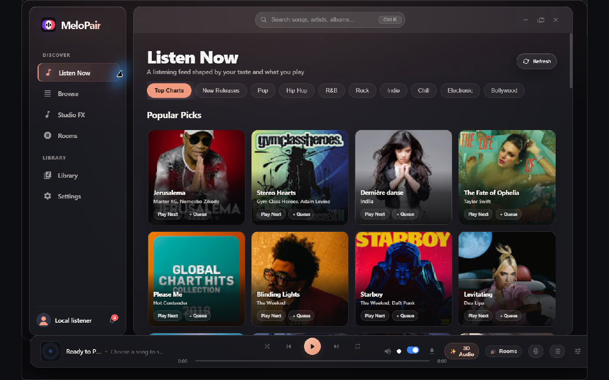

<div align="center">

# MeloPair

High-bitrate desktop music streaming with pioneer-style dual-deck crossfade, 3-line kinetic synced lyrics, Studio FX, and worldwide multi-device Rooms.

[](https://github.com/mohit4236b-svg/MeloPair/releases/latest/download/MeloPair-Setup-1.0.0.exe)

[Fallback: browse MeloPair releases](https://github.com/mohit4236b-svg/MeloPair/releases/latest)

</div>

## Key features

- **Dual-Deck Beat Crossfade** — seamless transitions between tracks with Web Audio gain ramps and smart preloading.
- **3-Line Kinetic Synced Lyrics & 1-Tap Realign** — multi-source lyrics over the animated Stars backdrop, with offset alignment, `↺ Realign`, and `±0.5s` fine-tuning.
- **Worldwide Multi-Device Rooms** — listen together over local Wi-Fi or a remote tunnel, with periodic playback drift correction.
- **Studio FX & Spatial Audio** — 5-band equalizer, sub-bass enhancement, and 3D spatial audio processing.
- **Audio-Only Stream Engine & Smart Queue** — filters music-video results, varies artists in autoplay, supports queue reordering, and imports listening taste from Spotify or YouTube Music.

## Screenshots




## Install on Windows

1. Download **MeloPair-Setup-1.0.0.exe** from the [latest release](https://github.com/mohit4236b-svg/MeloPair/releases/latest).
2. Run the installer. It installs per-user and does not require administrator access.
3. If Windows SmartScreen warns that the unsigned indie app is unrecognized, choose **More info → Run anyway** only if you trust this download.

The release installer bundles the required media and tunnel tools; Node.js, Python, `yt-dlp`, and FFmpeg do not need to be installed separately.

## Developer setup

```powershell
git clone https://github.com/mohit4236b-svg/MeloPair.git
cd MeloPair
npm install
npm start
```

To create a Windows x64 installer from a checkout, install the project dependencies and make sure the two root helper binaries referenced by `build.extraResources` (`yt-dlp.exe` and `cloudflared.exe`) are available locally, then run:

```powershell
npx electron-builder --win --x64
```

## License

MeloPair is distributed under the MIT License. Bundled third-party binaries retain their respective licenses in the installer resources.
